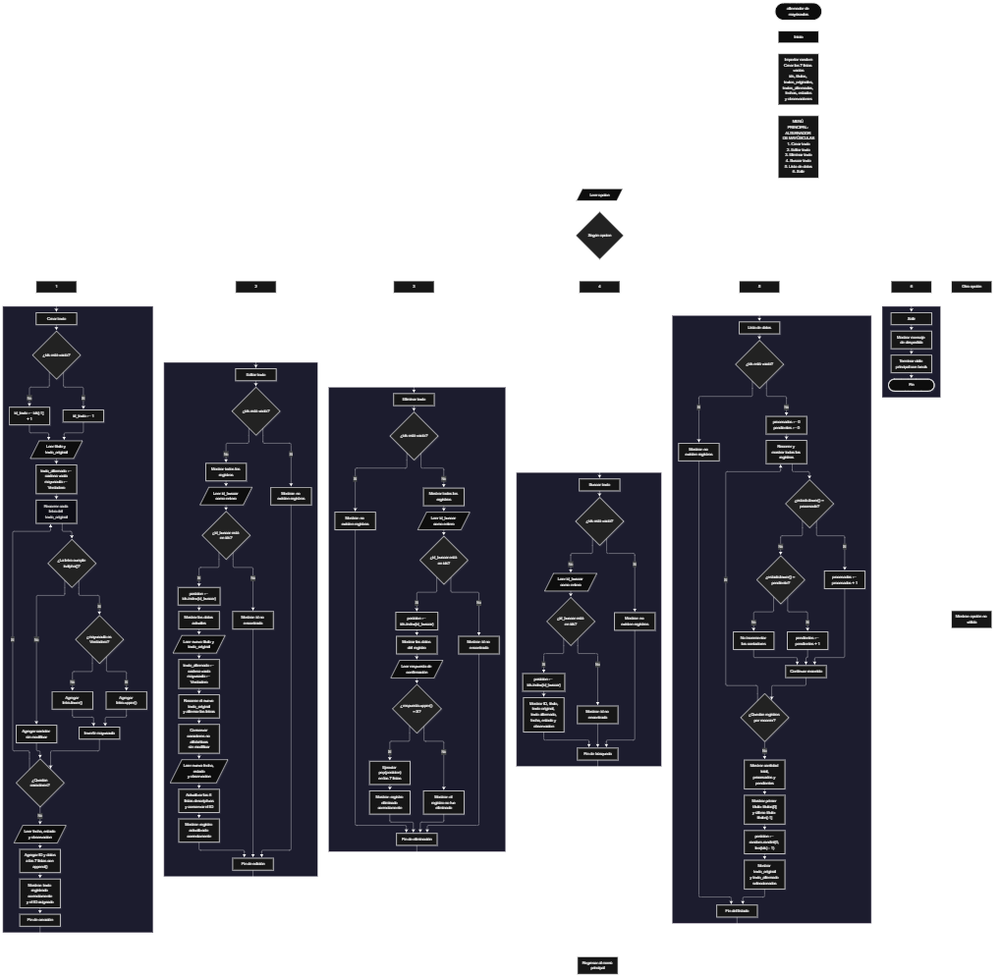

 

Este proyecto, llamado <b>alternador de mayúsculas</b>, fue desarrollado en <b>python</b> como un ejercicio práctico para fortalecer la lógica de programación mediante la creación de un sistema de gestión y transformación de textos desde la consola. El programa cuenta con un menú principal de seis opciones que permite <b>crear, editar, eliminar, buscar y listar textos, además de finalizar la ejecución</b>. Cada registro almacena información como el título, el texto original, el texto alternado, la fecha, el estado y las observaciones, utilizando siete listas paralelas que mantienen relacionados los datos mediante un identificador. La transformación alterna las letras entre mayúsculas y minúsculas, conservando los espacios, números y signos de puntuación sin modificar. Durante su desarrollo se aplicaron conceptos fundamentales de programación, como variables, listas, estructuras condicionales, ciclos repetitivos, métodos de cadenas y operaciones para administrar registros. Este proyecto permite poner en práctica los conocimientos adquiridos en python y sirve como base para desarrollar sistemas de procesamiento de textos más avanzados.

<h2 align="center">⚙️ Funcionamiento del menú principal</h2>

### ➕ Crear texto

La opción <b>1) crear texto</b> permite registrar un nuevo texto en el sistema. Antes de almacenar la información, el programa comprueba si la lista <b>ids</b> está vacía para asignar el identificador inicial <b>1</b>. Si existen registros, genera el siguiente identificador sumando uno al último valor almacenado mediante la expresión <b>ids[-1] + 1</b>. Después, solicita el <b>título, texto original, fecha, estado y observación</b>. Para transformar el texto, inicializa la variable <b>texto_alternado</b> como una cadena vacía y la variable <b>mayuscula</b> con el valor <b>verdadero</b>. A continuación, recorre cada carácter del texto original mediante un ciclo <b>for</b>. Si el carácter es una letra, comprueba la variable <b>mayuscula</b> para convertirla a mayúscula o minúscula mediante los métodos <b>upper()</b> y <b>lower()</b>. Después de procesar cada letra, invierte el valor de la variable para alternar la siguiente conversión. Los caracteres que no son letras se conservan sin cambios y no alteran la alternancia. Finalmente, almacena el identificador y los datos en las siete listas mediante <b>append()</b> y muestra los mensajes <b>"texto registrado correctamente."</b> y el identificador asignado.

### ✏️ Editar texto

La opción <b>2) editar texto</b> permite modificar la información de un texto registrado. Primero, el programa comprueba si existen registros mediante la lista <b>ids</b>. Si está vacía, muestra el mensaje <b>"no existen registros."</b>. En caso contrario, presenta los registros almacenados con sus respectivos datos y solicita el identificador que se desea editar. La entrada se convierte a un número entero mediante <b>int()</b> y se comprueba si el identificador existe en la lista <b>ids</b>. Si lo encuentra, utiliza <b>ids.index(id_buscar)</b> para obtener la posición del registro y mostrar sus datos actuales. Después, solicita el nuevo título y el nuevo texto original. El programa vuelve a ejecutar el procedimiento de alternancia de mayúsculas y minúsculas para generar el nuevo texto alternado. A continuación, actualiza las listas <b>titulos, textos_originales, textos_alternados, fechas, estados y observaciones</b>, conservando el identificador original. Finalmente, muestra el mensaje <b>"registro actualizado correctamente."</b>. Si el identificador no existe, presenta el mensaje <b>"id no encontrada."</b>.

### 🗑️ Eliminar texto

La opción <b>3) eliminar texto</b> permite eliminar un registro mediante su identificador. Antes de comenzar, el programa comprueba si existen datos almacenados. Si no hay registros, muestra el mensaje <b>"no existen registros."</b>. Si existen, presenta la lista de textos y solicita el identificador del registro que se desea eliminar. Cuando el identificador se encuentra en <b>ids</b>, obtiene su posición mediante <b>ids.index(id_buscar)</b> y muestra los datos correspondientes. Después, solicita una confirmación mediante el mensaje <b>"¿desea eliminar este registro? (s/n): "</b>. Si la respuesta, convertida a mayúsculas mediante <b>upper()</b>, es igual a <b>"S"</b>, elimina la posición seleccionada de las siete listas utilizando <b>pop(posicion)</b>. De esta manera, se mantienen relacionados los datos de los registros restantes. Finalmente, muestra el mensaje <b>"registro eliminado correctamente."</b>. Si el usuario no confirma la eliminación, presenta el mensaje <b>"el registro no fue eliminado."</b>. Si el identificador no existe, muestra el mensaje <b>"id no encontrada."</b>.

### 🔎 Buscar texto

La opción <b>4) buscar texto</b> permite localizar un registro mediante su identificador. Primero, el programa comprueba si la lista <b>ids</b> está vacía. Si no existen registros, muestra el mensaje <b>"no existen registros."</b>. En caso contrario, solicita el identificador que se desea buscar y convierte la entrada a un número entero. Después, comprueba si el identificador introducido está presente en la lista <b>ids</b>. Cuando encuentra una coincidencia, obtiene la posición correspondiente mediante <b>ids.index(id_buscar)</b> y muestra todos los datos del registro: identificador, título, texto original, texto alternado, fecha, estado y observaciones. Si el identificador no se encuentra, presenta el mensaje <b>"id no encontrada."</b>. Esta función facilita consultar un texto específico sin necesidad de recorrer manualmente todos los registros.

### 📋 Lista de datos

La opción <b>5) lista de datos</b> permite visualizar todos los textos registrados y consultar las estadísticas del sistema. Primero, comprueba si existen registros. Si no hay datos almacenados, muestra el mensaje <b>"no existen registros."</b>. En caso contrario, inicializa las variables <b>procesados</b> y <b>pendientes</b> en cero y utiliza un ciclo <b>for</b> para recorrer las listas y mostrar la información de cada texto. Durante el recorrido, comprueba el estado de cada registro mediante el método <b>lower()</b>. Si el estado es igual a <b>"procesado"</b>, aumenta el contador <b>procesados</b>; si es igual a <b>"pendiente"</b>, incrementa el contador <b>pendientes</b>. Al finalizar, muestra la cantidad total de textos, el número de textos procesados y pendientes, el título del primer registro mediante <b>titulos[0]</b> y el título del último mediante <b>titulos[-1]</b>. Finalmente, utiliza <b>random.randint(0, len(ids) - 1)</b> para seleccionar aleatoriamente una posición válida y presenta una demostración que compara el texto original con el texto alternado. Esta selección aleatoria únicamente muestra información existente y no modifica los registros.

### 🚪 Salir del menú principal

La opción <b>6) salir</b> permite finalizar la ejecución del programa. Cuando el usuario selecciona esta opción, se muestra el mensaje <b>"gracias por utilizar el alternador de mayúsculas."</b> y se ejecuta la instrucción <b>break</b>, que interrumpe el ciclo <b>while True</b> del menú principal. De esta manera, el usuario puede realizar diferentes operaciones de gestión y transformación de textos y finalizar el programa cuando lo desee.

<h2 align="center">🧠 Temas aplicados en el proyecto</h2>

### 📦 Variables

En este proyecto se utilizan variables para controlar la opción seleccionada en el menú, generar identificadores, almacenar temporalmente los datos introducidos por el usuario, transformar los textos, localizar registros y calcular las estadísticas. Cada variable cumple una función específica dentro de las operaciones de gestión y procesamiento de textos.

🔢 **Opcion:** Almacena la opción seleccionada por el usuario en el menú principal.

🆔 **Id_texto:** Almacena el identificador asignado al nuevo texto que se registra.

🔎 **Id_buscar:** Almacena el identificador introducido por el usuario para buscar, editar o eliminar un registro.

📝 **Titulo:** Almacena el título del texto que se está creando o modificando.

📄 **Texto_original:** Contiene el texto introducido por el usuario que se utilizará para realizar la transformación.

🔠 **Texto_alternado:** Almacena el resultado de convertir las letras del texto original alternando mayúsculas y minúsculas.

🔄 **Mayuscula:** Controla si la siguiente letra debe convertirse a mayúscula o minúscula.

📅 **Fecha:** Almacena la fecha asociada al registro.

📌 **Estado:** Almacena el estado del texto, que puede ser procesado o pendiente según los valores previstos por el programa.

📋 **Observacion:** Almacena la observación asociada al texto.

📊 **Procesados:** Cuenta los registros cuyo estado es igual a procesado, sin distinguir entre mayúsculas y minúsculas.

⏳ **Pendientes:** Cuenta los registros cuyo estado es igual a pendiente, sin distinguir entre mayúsculas y minúsculas.

🔢 **Posicion:** En las operaciones correspondientes, representa la posición del registro localizado o seleccionado aleatoriamente.

🔄 **I:** Funciona como contador en los ciclos utilizados para recorrer los registros y mostrar sus datos.

🎲 **Random:** Corresponde al módulo importado para seleccionar una posición aleatoria durante la demostración.

### 🗃️ Listas

En este proyecto se utilizan siete listas paralelas para almacenar la información de los textos. Cada lista contiene un tipo de dato y mantiene la misma posición para representar un registro determinado. Por ejemplo, la información del texto ubicado en la posición <b>0</b> se distribuye entre <b>ids[0], titulos[0], textos_originales[0], textos_alternados[0], fechas[0], estados[0] y observaciones[0]</b>. Esta organización permite recorrer, buscar, actualizar, mostrar y eliminar los registros conservando la relación entre sus datos. Las listas se mantienen en memoria durante la ejecución y no cuentan con almacenamiento permanente.

🆔 **Ids:** Almacena los identificadores de los textos registrados.

📝 **Titulos:** Almacena los títulos asociados a cada texto.

📄 **Textos_originales:** Contiene los textos originales introducidos por el usuario.

🔠 **Textos_alternados:** Almacena los textos transformados mediante la alternancia de mayúsculas y minúsculas.

📅 **Fechas:** Guarda las fechas asociadas a los registros.

📌 **Estados:** Almacena los estados de los textos.

📋 **Observaciones:** Contiene las observaciones correspondientes a cada registro.

### 🔀 Estructuras condicionales

En este proyecto se utilizan las estructuras <b>if, elif y else</b> para controlar las opciones del menú principal y tomar decisiones según los datos almacenados. Estas estructuras permiten comprobar si existen registros antes de realizar determinadas operaciones, verificar si un identificador está presente en la lista, decidir qué conversión aplicar a cada letra, determinar si se confirma una eliminación y clasificar los textos según su estado. También permiten mostrar un mensaje cuando el usuario selecciona una opción que no está contemplada en el menú.

### 🔄 Estructuras repetitivas

El programa utiliza los ciclos <b>while</b> y <b>for</b> para ejecutar las operaciones repetitivas. El ciclo <b>while True</b> mantiene activo el menú principal hasta que el usuario selecciona la opción de salida y se ejecuta <b>break</b>. Los ciclos <b>for</b> permiten recorrer los caracteres del texto original para generar la transformación y recorrer los registros almacenados para mostrar su información. Estas estructuras facilitan el procesamiento de textos y la administración de múltiples registros sin tener que repetir manualmente las instrucciones.

### 🔠 Métodos de cadenas

Los métodos de cadenas permiten examinar y transformar los caracteres del texto original. El método <b>isalpha()</b> comprueba si cada carácter es una letra. Los métodos <b>upper()</b> y <b>lower()</b> convierten las letras a mayúsculas o minúsculas, respectivamente. Además, <b>lower()</b> se utiliza para comparar los estados sin distinguir entre mayúsculas y minúsculas, mientras que <b>upper()</b> facilita aceptar tanto la letra <b>s</b> como la letra <b>S</b> al confirmar la eliminación de un registro.

### 🧰 Métodos y funciones de listas

El programa utiliza distintas operaciones para administrar las listas paralelas. El método <b>append()</b> agrega los datos de un nuevo registro al final de cada lista. El método <b>index()</b> permite localizar la posición de un identificador existente. El método <b>pop()</b> elimina el elemento situado en la posición seleccionada. La función <b>len()</b> permite comprobar si existen registros y calcular la cantidad total de textos almacenados. Por su parte, el acceso mediante índices permite consultar datos específicos y obtener el primer y último título registrado.

### 🎲 Módulo random

El módulo <b>random</b> se importa al inicio del programa y se utiliza en la opción de lista de datos. Mediante la función <b>random.randint(0, len(ids) - 1)</b>, el programa obtiene una posición aleatoria comprendida entre el primer índice válido y el último índice ocupado. La posición seleccionada se utiliza para mostrar un texto original y su correspondiente texto alternado. Esta demostración permite observar la transformación de un registro elegido al azar, sin agregar, eliminar ni modificar información.

### 🔢 Generación de identificadores

El programa asigna identificadores a los nuevos registros mediante la variable <b>id_texto</b>. Cuando la lista <b>ids</b> está vacía, el identificador inicial es <b>1</b>. Si ya existen registros, se toma el último identificador almacenado y se suma uno mediante <b>ids[-1] + 1</b>. Este procedimiento permite identificar los registros durante las operaciones de búsqueda, edición y eliminación. Sin embargo, como el siguiente identificador se calcula a partir del último elemento de la lista, si se elimina el registro con el identificador más alto, ese valor podría volver a utilizarse al crear otro texto.

<h2 align="center">¿Cómo se implementaron las operaciones crud en el proyecto?</h2>

Las operaciones <b>crud</b> se implementaron mediante las opciones del menú principal y permiten administrar los textos registrados. La operación <b>crear</b> corresponde a <b>crear texto</b>, donde se solicita la información y se genera el texto alternado; <b>leer</b> se realiza mediante las opciones <b>buscar texto y lista de datos</b>, que permiten consultar un registro específico o visualizar todos los registros y sus estadísticas; <b>actualizar</b> corresponde a <b>editar texto</b>, donde se modifican los datos y se vuelve a calcular la transformación del texto original; y <b>eliminar</b> se realiza mediante <b>eliminar texto</b>, que solicita confirmación antes de quitar los datos de las listas. Estas operaciones utilizan identificadores y posiciones para mantener relacionados los datos durante la ejecución del programa.

<h2 align="center">Diagrama de flujo del proyecto</h2>

<h2 align="center">🛡️ Validaciones del programa</h2>

### 📭 No existen registros

Esta comprobación se utiliza en las opciones de <b>editar, eliminar, buscar y lista de datos</b>. El programa verifica si la lista <b>ids</b> está vacía y, cuando no existen textos almacenados, muestra el mensaje <b>"no existen registros."</b>. Esta condición evita continuar con las operaciones que necesitan datos existentes para mostrar, localizar, modificar o eliminar un registro.

### 🔎 Identificador no encontrado

Esta comprobación se utiliza durante las operaciones de <b>editar, eliminar y buscar texto</b>. El programa verifica si el identificador introducido está presente en la lista <b>ids</b>. Si existe, obtiene su posición con <b>ids.index(id_buscar)</b> y continúa con la operación correspondiente. Si no existe, muestra el mensaje <b>"id no encontrada."</b>, evitando modificar o eliminar un registro que no se encuentra almacenado.

### 🗑️ Confirmación de eliminación

Antes de eliminar un registro, el programa muestra sus datos y solicita confirmación mediante una entrada de texto. La condición <b>respuesta.upper() == "S"</b> permite aceptar la confirmación tanto si el usuario introduce <b>s</b> como si introduce <b>S</b>. Cuando la respuesta coincide, se elimina el registro de las siete listas. En caso contrario, se conserva el registro y se muestra el mensaje <b>"el registro no fue eliminado."</b>.

### 📌 Conteo de estados

Durante la opción <b>5) lista de datos</b>, el programa utiliza los contadores <b>procesados</b> y <b>pendientes</b> para clasificar los registros. El método <b>lower()</b> permite comparar los estados sin distinguir entre mayúsculas y minúsculas. Los registros cuyo estado sea <b>"procesado"</b> se suman al primer contador y los que tengan el estado <b>"pendiente"</b> se suman al segundo. Los valores distintos de esos dos estados no se incluyen en ninguno de los contadores. El programa no impide introducir otros estados al crear o editar un registro.

### ⚠️ Opción no válida

La estructura condicional del menú incluye un bloque <b>else</b> que muestra el mensaje <b>"opción no válida."</b> cuando el valor introducido no coincide con las opciones disponibles del <b>1</b> al <b>6</b>. Esta respuesta permite informar al usuario de que debe seleccionar una de las opciones definidas para continuar utilizando el programa.

### ⚠️ Entrada de identificadores

En las opciones de edición, eliminación y búsqueda, el programa utiliza <b>int(input(...))</b> para convertir el identificador introducido en un número entero. Sin embargo, el código actual no incluye un bloque <b>try/except</b> para manejar entradas que no sean numéricas. Por este motivo, si el usuario introduce letras u otro valor que no pueda convertirse a entero, el programa puede finalizar con un error. Esta es una limitación de la versión actual y no una validación implementada.

### 💾 Almacenamiento temporal

Los registros se guardan en las listas de Python durante la ejecución del programa. El código actual no utiliza archivos, bases de datos ni otros mecanismos de persistencia. Por tanto, cuando termina la ejecución, la información almacenada en memoria se pierde. Las listas paralelas deben conservar la misma cantidad de elementos y el mismo orden para mantener correctamente relacionados los datos de cada texto.

<h2 align="center">🎯 Objetivo del proyecto</h2>

El objetivo principal de este proyecto es fortalecer la <b>lógica de programación</b> mediante el desarrollo de un sistema de gestión y transformación de textos en <b>python</b>. A través de su construcción se busca aplicar conocimientos sobre variables, listas, estructuras condicionales, ciclos repetitivos, métodos de cadenas y funciones integradas, combinándolos para resolver un problema de manera organizada. Además, el proyecto permite comprender cómo registrar, consultar, modificar y eliminar información, así como procesar caracteres para alternar mayúsculas y minúsculas. De esta manera, constituye una base práctica para desarrollar aplicaciones de procesamiento de textos y sistemas de gestión más completos con otros lenguajes y tecnologías.

